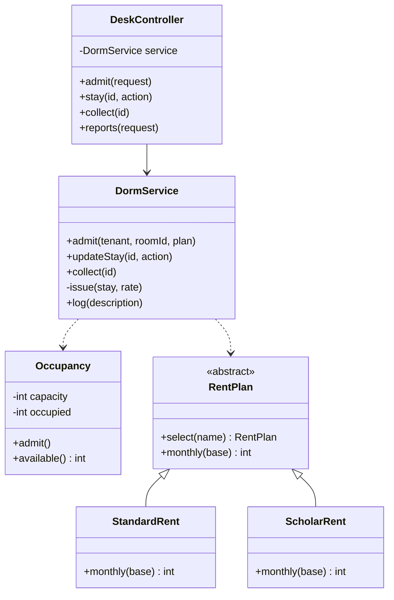
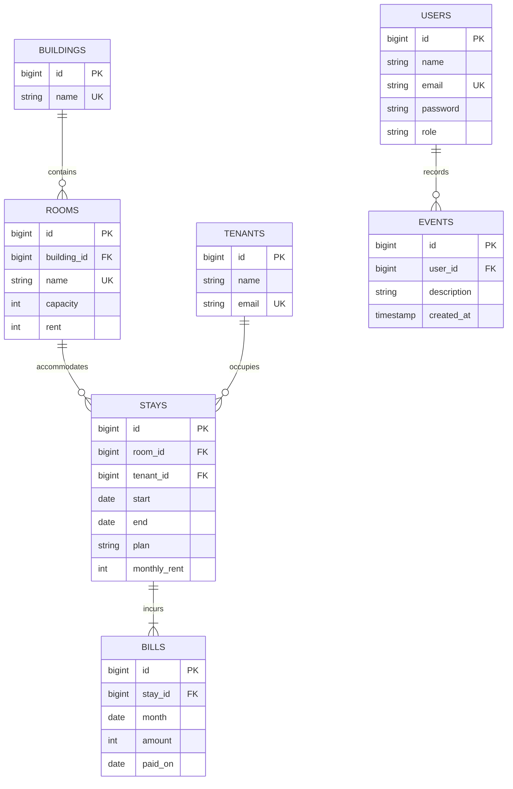

# Dorm Desk design
The front desk uses a staff-only MVC application. Routes select a controller, controllers validate input, the service enforces business rules inside transactions, and Blade renders records and errors.

## Class diagram

## Entity relationship diagram

## OOP walkthrough
- Encapsulation: app/Domain/Occupancy.php keeps occupancy private. admit() can increment it only when capacity permits.
- Abstraction: app/Domain/RentPlan.php defines monthly() and supplies select() to resolve a named plan.
- Inheritance: app/Domain/StandardRent.php and app/Domain/ScholarRent.php extend RentPlan. Each overrides monthly().
- Polymorphism: app/Domain/DormService.php calls monthly() on the selected plan during admit(). Its return value sets the agreed rent and first bill.
- Database invariants: each bill has a unique (stay_id, month). A null end means an active stay. A null paid_on means an unpaid bill. Parent foreign keys protect history.
